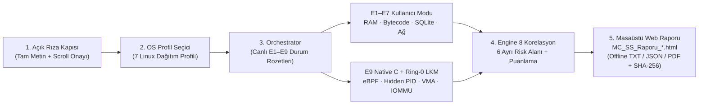

<div align="center">


# MC SS Sentinel

**Linux için 9 Katmanlı Derin Adli Hile Kontrol (ScreenShare / SS) & Geçici Ring-0 Çekirdek / eBPF / IOMMU Analiz Aracı**

<p align="center">
  <a href="https://github.com/CmdSuv/SS-KERNEL-LINUX/releases/latest">
    
  </a>
  
  
  
  
  
</p>

<p align="center">
  <a href="#-mimari-akış">Mimari</a> •
  <a href="#-9-adli-analiz-katmanı-e1e9">9 Katman</a> •
  <a href="#-etkileşimli-çevrimdışı-web-raporu-v13">Web Raporu</a> •
  <a href="#-çift-taraflı-yanlış-pozitif--sıfır-baypas-kalkanı">FP &amp; Baypas Kalkanı</a> •
  <a href="#-desteklenen-7-linux-dağıtımı">Dağıtımlar</a> •
  <a href="#-kurulum-ve-kullanım">Kurulum</a> •
  <a href="#-sıkça-sorulan-sorular-sss">SSS</a> •
  <a href="#-lisans-ve-telif-hakkı">Lisans</a>
</p>

</div>

---

> [!IMPORTANT]
> **%100 Yerel · Açık Rıza Kapılı · Salt-Okunur Tarama**
> MC SS Sentinel hiçbir dış sunucuya veri, telemetri veya rapor göndermez. Açılışta en alta kaydırılmadan onaylanmayan **Açık Rıza Sözleşmesi** ile başlar; tüm tarama motorları tamamen **salt-okunurdur** (yalnızca kullanıcının açıkça seçtiği *IOMMU/DMA Korumasını Aç* işlevi önyükleyici yapılandırmasına `.mc_ss_sentinel.bak` yedeği alarak yazar).

---

## 🎯 Nedir ve Neden Farklıdır?

Klasik yalnızca dosya adına veya basit metin eşleşmesine bakan SS araçlarının aksine **MC SS Sentinel**, Linux sistemlerde hem kullanıcı modundaki (**Ring-3**) hem de çekirdek modundaki (**Ring-0**) izleri çapraz doğrulayarak bir araya getirir:

| Özellik | Açıklama |
| :--- | :--- |
| **9 Bağımsız Analiz Motoru (`E1`–`E9`)** | Sistem bütünlüğü, canlı `/proc/<pid>/mem` RAM taraması, girdi/makro aygıtları, `.jar`/`.class` sabit havuzu & X-Ray piksel analizi, Minecraft/Launcher/Wine-Bottles izleri, SQLite freelist kazıması, ağ/USB soketleri, çoklu motor korelasyonu ve Ring-0 çekirdek analizi. |
| **Geçici "Gir-Tara-Çık" Ring-0 LKM** | Polkit onayıyla x86_64 çekirdeklerde (`5.15`–`7.3+`) yalnızca tarama süresince [`kernel/mc_ss_kmod.c`](kernel/mc_ss_kmod.c) yüklenir, bellek/VMA/`ftrace`/syscall/VFS anlık görüntüsünü alır ve tarama bitmeden temiz biçimde `rmmod` ile kaldırılır. |
| **Pure C Kullanıcı-Modu Sondası** | [`native/ss_kernel_probe.c`](native/ss_kernel_probe.c) ile `sys_bpf` eBPF program/link denetimi, `getdents64` gizli PID cross-view karşılaştırması ve 4 KB PCIe yapılandırma alanı DMA taraması. |
| **Etkileşimli Çevrimdışı Web Raporu (`v1.3`)** | Tarama bitiminde Masaüstüne tek-dosya, `%100` çevrimdışı **`MC_SS_Raporu_*.html`** yazar; 6 ayrı risk alanı, anlık arama/filtreleme, SHA-256 doğrulama ve tek tıkla **`TXT` / `JSON` / `PDF`** dışa aktarma sunar. |
| **Ekran Paylaşımı (SS) Dostu Qt6 Arayüzü** | Tarama tamamlandığında canlı **E1–E9 motor durum rozetlerini** gösterir; pencerede kırmızı karar/suçlama metni basmaz, tek tıkla tarayıcıda açılan raporu Masaüstüne kaydeder. |
| **Çift-Taraflı Yanlış-Pozitif Koruması** | Gerçek masaüstü bileşenleri (`Krypton`, `C2ME`, `Fabric`, `Netty`, `GammaUtils`, `Firefox Flatpak`, `Electron`, `Gradle`, `Roblox`, `ciadpi` Discord proxy, PyInstaller `_MEI`) ile bunların truvalı/sahte saldırı ikizleri **89 birim & red-team testiyle** birlikte sınanır. |

---

## 🧭 Mimari Akış



---

## 🔬 9 Adli Analiz Katmanı (E1–E9)

| Motor | Katman | Öne Çıkan Tespit Kabiliyetleri |
| :---: | :--- | :--- |
| **E1** | **Sistem Bütünlüğü** | `uptime`, `ptrace_scope`, saat/NTP geriye alma, Bash/Zsh/Fish geçmiş temizliği (`history -c`, `shred`, `truncate`), `LD_PRELOAD`/`LD_AUDIT`, `$PATH` gölgeleme, `journalctl` / `coredumpctl` |
| **E2** | **Canlı Süreçler & RAM** | `/proc` süreç ağacı, `/proc/<pid>/maps` & `smaps` `.text` yama kontrolü, `memfd:` / yürütülebilir silinmiş `.jar`/`.so`, Prefix-Trie tek geçişli Java/Minecraft RAM imza taraması, `hsperfdata`, `jcmd`, container & Wine/Proton tespiti |
| **E3** | **Girdi & Makro** | `/dev/uinput` gizli sanal aygıtlar (`sysfs`), `/proc/bus/input/devices`, `input-remapper`, Solaar, Piper/`ratbagd`, OpenRazer, AutoKey, XClicker, `ydotool`/`dotool`/XTest makro betikleri |
| **E4** | **Derin Dosya & Bytecode** | `.minecraft` & tüm launcher'lar, `Downloads`, `Desktop`, `/tmp`, `/dev/shm`; `.jar`/`.class` sabit havuzu (Mixin/cheat API/obfuscator), gömülü native `.so`/`.dll`/`.dylib` analizi, Adam7/4-bit X-Ray PNG piksel taraması, polyglot dosyalar, `statx` timestomp, `xattr` |
| **E5** | **Minecraft İzleri** | Vanilla, Prism, Lunar (`optionslc`), Modrinth, HMCL, Wine/Proton & Bottles profilleri; `options.txt`, oyun logları, logdan silinmiş yasaklı mod korelasyonu, `hs_err_pid` |
| **E6** | **Masaüstü & Tarayıcı** | `recently-used.xbel`, pano/Klipper, Çöp Kutusu (yetim dosyalar dâhil), Chromium/Firefox/Snap SQLite geçmiş + WAL + freelist URL kazıması, Wine/Bottles `user.reg` (ROT13 UserAssist), `.java/.userPrefs` |
| **E7** | **Ağ & USB** | `/proc/net` soket eşleştirme, VPN tünelleri, yerel SOCKS/HTTP proxy portları (oyun bağlantısı vs. DPI-bypass ayrımı), `/etc/hosts` yönlendirmeleri, USB donanım geçmişi |
| **E8** | **Korelasyon & Raporlama** | Çoklu motor zincirleri (`WIPE-CHAIN`, `GHOST-RAM`, `JVM-INJECT`, `RING0-ROOTKIT`, `DMA-EXPOSURE`), 6 alanlı açıklanabilir puanlama ve çevrimdışı `.html` / `.txt` / `.json` / `.sha256` çıktıları |
| **E9** | **Ring-0 Kernel & eBPF/DMA** | Geçici `mc_ss_kmod.ko` (`5.15–7.3+`), `ss_kernel_probe` (`sys_bpf` + `getdents64` gizli PID + PCIe 4 KB config), `ftrace`/syscall/VFS kanca taraması, yetim kernel bellek/VMA taraması, **IOMMU/DMA** denetimi ve tek tıkla koruma |

<details>
<summary><b>📂 Motor Detaylarını Aç — E1–E3 (Sistem Bütünlüğü, Canlı RAM & Girdi/Makro)</b></summary>

- **E1 (`ss_core/engine1_integrity.py`):**
  - Shell geçmişinde açık anti-forensic silme komutları (`history -c`, `rm ~/.bash_history`, `unset HISTFILE`) `CRITICAL` olarak işaretlenirken zaman damgasız rutin `journalctl --rotate` / `--vacuum-time` bakımları `MEDIUM` olarak kalibre edilir.
  - `$PATH` üzerinde sistem ikililerini gölgeleyen kullanıcı dizini ikililerini ve `LD_PRELOAD` / `LD_AUDIT` ortam manipülasyonlarını denetler.
- **E2 (`ss_core/engine2_live_proc.py`):**
  - **Prefix-Trie Regex Motoru** (`build_str_trie_pattern` / `build_bytes_trie_pattern`) ile `369` katı hile imzası + `214` modül adını canlı bellek üzerinde tek geçişte tarar.
  - Yürütülebilir (`r-xp`/`rwxp`) silinmiş `.so`/`.jar` haritalamalarını, `memfd:` dosya-dışı çalıştırmaları ve yansımalı (reflective) ELF başlıklarını yakalar; buna karşılık `dconf/user (deleted)`, sistem uygulama mağazaları (`bazaar`), Firefox Flatpak `libmozsandbox.so`, Electron `app.asar` JIT alanları ve Gradle Daemon `-javaagent` süreçlerini yanlış-pozitif üretmeden ayırt eder.
- **E3 (`ss_core/engine3_input_macro.py`):**
  - Sahte isimle gizlenen `/dev/uinput` sanal aygıtlarını `sysfs` üzerinden yakalar; donanım makro yazılımlarını (`Solaar`, `Piper`, `OpenRazer`, `input-remapper`) ve `XTest`/`xdotool`/`ydotool`/`dotool` oto-tıklayıcılarını tarar.

</details>

<details>
<summary><b>📂 Motor Detaylarını Aç — E4–E6 (Bytecode/X-Ray, Minecraft & Tarayıcı Kazıması)</b></summary>

- **E4 (`ss_core/engine4_deep_files.py`):**
  - `.jar` içi `.class` sabit havuzunu (Constant Pool) ayrıştırarak gizli Mixin hedeflerini, obfuscator imzalarını (`14` tür), gömülü native kütüphanelerdeki (`Agent_OnLoad`, `RedefineClasses`) truva atlarını ve `Jar-in-Jar` saklamalarını ortaya çıkarır.
  - `32` X-Ray hassas blok dokusunda şeffaf piksel ve `parent: air` blok modeli hilelerini (Adam7 & 4-bit indexed PNG dâhil) yakalar.
  - `statx` doğum/değişiklik zamanı tutarsızlıklarını (`timestomp`), PE/ELF enjektör kombinasyonlarını (`VirtualAllocEx` + `WriteProcessMemory` + `CreateRemoteThread`, `ptrace` + `process_vm_writev`) ve çok-biçimli (polyglot) dosyaları tespit eder.
- **E5 (`ss_core/engine5_minecraft.py`):**
  - Vanilla, Prism, Lunar, Modrinth, HMCL, Wine/Proton ve Bottles (yerel + Flatpak) profillerini tarar; logda yüklenip diskten sonradan silinen hile ve kısıtlı utility modlarını (`E5-LOG-MISSING-RESTRICTED-MOD`) çapraz kontrol eder.
- **E6 (`ss_core/engine6_desktop_traces.py`):**
  - Tarayıcı SQLite veritabanlarındaki aktif kayıtların yanı sıra `-wal` ve boş sayfalar (`freelist`) üzerinden silinmiş hile indirme/ziyaret URL'lerini kazır. `v1.3`'te `_norm_url_key` normalizasyonu ile aktif indirmelerin WAL sayfa çerçeveleme gürültüsünden kaynaklanan sahte freelist uyarıları tamamen temizlenmiştir.

</details>

<details>
<summary><b>📂 Motor Detaylarını Aç — E7–E9 (Ağ/Proxy, Korelasyon & Ring-0 Kernel/eBPF/DMA)</b></summary>

- **E7 (`ss_core/engine7_network_usb.py`):**
  - `/proc/net/tcp*` soketlerini süreç inode'larıyla eşleştirerek yerel SOCKS5/HTTP vekillerini inceler: `ciadpi` gibi DPI-bypass araçları yalnızca Discord tarafından kullanılıyorsa `LOW`, aynı porta `java` / Minecraft bağlandığında otomatik `HIGH` raporlanır.
- **E8 (`ss_core/engine8_reporter.py`):**
  - Tekil bulguların ötesinde çoklu motor korelasyon kurallarıyla (`WIPE-CHAIN`, `GHOST-RAM`, `JVM-INJECT`, `RING0-ROOTKIT`, `DMA-EXPOSURE`) birleşik saldırı örüntülerini yakalar ve 6 ayrı risk alanına ayırır.
- **E9 (`ss_core/engine9_kernel.py` · `kernel/mc_ss_kmod.c` · `native/ss_kernel_probe.c`):**
  - Tüm çekirdek kaynakları ve native C sondası derleme anında SHA-256 ile [`ss_core/_self_manifest.py`](ss_core/_self_manifest.py) içine mühürlenir.
  - Gizli süreçleri (`task_struct` vs `/proc` cross-view), `ftrace`/syscall/VFS kancalarını, anonim/yetim kernel VMA enjeksiyonlarını, şüpheli `eBPF` (`KPROBE`/`TRACEPOINT`/`LSM`) programlarını ve PCIe FPGA/Screamer DMA risklerini denetler.

</details>

---

## 🌐 Etkileşimli Çevrimdışı Web Raporu (`v1.3`)

Tarama tamamlandığında Masaüstüne doğrudan tıklanarak varsayılan tarayıcıda açılan **tek-dosya, `%100` çevrimdışı HTML5 web raporu (`MC_SS_Raporu_YYYYMMDD_HHMMSS.html`)** yazılır:

- **6 Bağımsız Risk Alanı Ayrımı:**
  1. `Hile Kanıtı` — Doğrudan hile istemcisi, enjektör, RAM/bytecode ve yasaklı mod bulguları
  2. `Adli Manipülasyon` — Geçmiş temizliği, silinmiş kanıt kazıması, timestomp, log silme
  3. `Çekirdek Bütünlüğü` — Ring-0 kancaları, gizli PID, şüpheli eBPF, yetim VMA
  4. `DMA / Donanım` — IOMMU durumu, PCIe FPGA/Screamer ve USB donanım anomalileri
  5. `Sistem Güvenliği` — `ptrace_scope`, önyükleme/güvenlik duruşu notları
  6. `Tarama Kapsamı` — Hangi motorların/yetkilerin çalıştığını gösteren tam şeffaflık özeti
- **Tarayıcı İçi Etkileşimli Araçlar:** Önem derecesi (`CRITICAL` / `HIGH` / `MEDIUM` / `LOW` / `INFO`), motor (`E1`–`E9`) ve risk alanı filtreleri, anlık metin araması, açılır-kapanır kanıt kartları ve rapor **SHA-256** bütünlük rozeti.
- **Tek Tıkla Çevrimdışı Dışa Aktarma:** Rapor sayfasının içinden haricî araç gerektirmeden **`TXT`**, **`JSON`** veya yazdırılabilir **`PDF`** çıktısı alınabilir.

<details>
<summary><b>📊 İmza Veritabanı & Kapsam Sayıları (Koddan Doğrulanmış)</b></summary>

| Kategori | Adet | Kapsam Örnekleri |
| :--- | :---: | :--- |
| **Katı Hile & Enjektör İmzaları** (`STRICT_CHEAT_IDENTIFIERS`) | **369** | `Vape`, `Slinky`, `Entropy`, `Drip`, `Whiteout`, `Meteor`, `LiquidBounce`, `Wurst`, `Rise`, `Augustus`, `Raven`, `Nursultan`, `Expensive`, `Doomsday`, `Trouser-Streak`, `Meteor-Rejects` vb. |
| **Bağlamsal Modül İsimleri** (`CONTEXTUAL_CHEAT_MODULES`) | **214** *(136 yüksek sinyalli)* | `BetterMaceSwap`, `SmartMaceSwap`, `AutoStunSlam`, `AutoWindCharge`, `SpearSwap`, `AutoLungeSwap`, `CrystalMacro`, `AnchorMacro`, `AutoTotem`, `KillAura`, `TriggerBot` vb. |
| **Kısıtlı / Yasaklı Utility Modları** (`RESTRICTED_UTILITY_MOD_IDENTIFIERS`) | **31** | `Tweakeroo`, `InvMove`, `ChestTracker`, `HealthIndicators`, `BetterPvP`, `HotbarOptimizer`, `GammaUtils`, `Fullbright`, `EasyPlace`, `InventoryProfilesNext` vb. (`MEDIUM`) |
| **Güvenilir Mod Kimlik Koruması** (`POPULAR_MOD_IDENTITY_MAP`) | **47** | `Sodium`, `Iris`, `Lithium`, `Krypton`, `C2ME`, `ModernFix`, `Indium`, `Dynamic FPS`, `Cloth Config`, `YACL`, `Spark`, `Jade`, `EMI` vb. (sahte-isim kalkanı) |
| **Hile Alan Adları** (`CHEAT_DOMAINS`) | **57** | Tarayıcı geçmişi, WAL ve SQLite freelist kazıması |
| **X-Ray Hassas Blok Dokuları** (`XRAY_SENSITIVE_BLOCK_TEXTURES`) | **32** | Elmas/antik kalıntı/taş/deepslate şeffaflık ve `parent: air` kontrolü |

</details>

---

## 🛡️ Çift-Taraflı Yanlış-Pozitif & Sıfır-Baypas Kalkanı

`v1.3` ile eklenen [`tests/test_false_positive_and_bypass_regression.py`](tests/test_false_positive_and_bypass_regression.py) paketi, gerçek Linux masaüstlerindeki **her meşru senaryoyu doğrudan saldırgan ikiziyle eşleştirerek** yanlış-pozitiflerin baypas açmadan temizlendiğini kanıtlar:

<details>
<summary><b>✅ Meşru Senaryo vs. Saldırı İkizi Doğrulama Matrisi (Tıklayıp Açın)</b></summary>

| Gerçek Masaüstü Meşru Durumu (`0` Yanlış-Pozitif) | Karşıt Saldırı Senaryosu (Hâlâ `CRITICAL`/`HIGH` Yakalanır) |
| :--- | :--- |
| Sentinel'in kendi PyInstaller `/tmp/_MEI*` VMA'ları, geçici helper PID'i ve AppImage `.mount_*` | `/tmp/injected_cheat.so` VMA haritası ve gizli `evil_rk` rootkit PID'i (`E9-HIDDEN-PID-RING0`) |
| Dağıtımın yerleşik `LSM` `userns_restrict` eBPF programı | `userns_restrict` adını taklit eden `KPROBE` `__x64_sys_getdents64` eBPF rootkit'i (`E9-EBPF-SUSPICIOUS-PROG`) |
| `/usr/bin/bazaar` (Flathub metni), `dconf/user (deleted)`, Wine `rw-p` tampon, Firefox Flatpak `libmozsandbox.so`, Electron `app.asar`, Gradle Daemon `-javaagent` | `/tmp/bazaar` taklidi, yürütülebilir `r-xp` silinmiş `.so`, `rwxp` reflective ELF ve Minecraft'ta taklit `-javaagent` / `LD_PRELOAD` |
| Vanilla `1.21.11`/`26.3+`, Fabric API, Netty, Krypton (`velocity-cipher.dylib`), C2ME native, `jctools` `Unsafe`, `GammaUtils` (`MEDIUM`) | Sahte `krypton-fake.jar` (`KillAura`), `Agent_OnLoad` içeren truvalı `velocity-cipher.so` (`E4-JAR-EMBEDDED-NATIVE`) |
| `RobloxPlayerInstaller.exe` (`FluxClient` UI metni) ve bare `ptrace` kullanan SS araçları | Win32 enjeksiyonlu (`VirtualAllocEx` + `WriteProcessMemory` + `CreateRemoteThread`) sahte PE ve `ptrace + process_vm_writev` ELF enjektörü |
| Aktif Discord CDN indirmesinin SQLite WAL gürültü baytları | SQLite WAL/freelist içinden kazınan silinmiş `vape.gg` indirme kaydı (`E6-BROWSER-SQLITE-FREELIST-CARVE`) |
| Yalnızca Discord'a hizmet veren `ciadpi` yerel SOCKS5 vekili (`LOW`) ve zaman damgasız `journalctl --rotate` (`MEDIUM`) | Aynı yerel SOCKS5 vekiline `java` / Minecraft bağlantısı (`HIGH`) ve `history -c` geçmiş temizliği (`CRITICAL`) |

</details>

---

## 🐧 Desteklenen 7 Linux Dağıtımı

Her hedef kendi `glibc` ve çekirdek başlıklarıyla izole konteynerlerde derlenir ve taşınabilir `MC-SS-Sentinel.desktop` kısayoluyla birlikte gelir:

| Hedef Kimliği | Desteklenen Dağıtımlar | Öne Çıkan Platform Uyumları |
| :--- | :--- | :--- |
| `bazzite` | Bazzite · Fedora Silverblue / Kinoite (Atomic) | `rpm-ostree`, `kargs` IOMMU, `glibc >= 2.42` |
| `fedora_nobara` | Fedora 43/44/45 Workstation · Nobara | `dnf`, `grubby`, `kernel-devel` |
| `ubuntu_24_04` | Ubuntu 24.04 LTS (Noble) · Pop!_OS 24.04 | Snap tarayıcı yolları, `AppArmor`, `GRUB` / `kernelstub` |
| `ubuntu_22_04` | Ubuntu 22.04 LTS (Jammy) · Pop!_OS 22.04 | `5.15 GA` & `6.8 HWE` çekirdek uyumu |
| `debian` | Debian 12 Bookworm · Debian 13 Trixie · MX Linux · Pardus · Kali | `apt`, `linux-headers`, `glibc >= 2.36` |
| `arch_cachyos` | Arch Linux · CachyOS · EndeavourOS · Manjaro · Garuda | `GCC` ve `Clang/LLVM=1` CachyOS çekirdekleri, `AUR`/`pacman` |
| `steamos` | SteamOS 3 · Valve Holo · Steam Deck | MicroSD (`/run/media`) otomatik keşif, salt-okunur kök FS uyumu |

---

## 🚀 Kurulum ve Kullanım

### Gereksinimler
- **Python `>= 3.10`** ve **`PySide6`** (`python3-pyside6` / `pyside6`)
- **`gcc`, `make`** (yerel C sondası [`native/ss_kernel_probe.c`](native/ss_kernel_probe.c) derlemesi için)
- *(Opsiyonel Ring-0 LKM için)* Çalışan çekirdeğe uygun `kernel-devel` / `linux-headers-$(uname -r)` ve `kmod`

### 1. Hızlı Başlatma (Kaynaktan)
```bash
# 1) Native C sondasını derle
make -C native

# 2) Masaüstü arayüzünü başlat (Açık Rıza -> OS Seçici -> Tarama -> Web Raporu)
python3 ss_gui.py

# 3) veya doğrudan CLI / Headless tarama (Masaüstüne MC_SS_Raporu_*.html yazar)
python3 ss_gui.py --headless-scan --target-os auto
python3 ss_sentinel.py --help
```

### 2. Test Paketini Çalıştırma
```bash
QT_QPA_PLATFORM=offscreen python3 tests/run_all_tests.py
```

<details>
<summary><b>📦 Konteyner İçinde Tek-Parça ELF Derleme (Podman / Docker)</b></summary>

Her dağıtımın kendi `glibc` ve çekirdek başlıklarıyla tek dosya (`targets/<hedef>/MC-SS-Sentinel`) ve taşınabilir `MC-SS-Sentinel.desktop` üretmek için:

```bash
# Tek bir hedef için
python3 scripts/build_distro_targets.py --targets bazzite --cpus 6 --memory 4g --cleanup-image

# Tüm 7 hedef için
python3 scripts/build_distro_targets.py --targets all --cpus 6 --memory 4g --cleanup-image
```

Bütünlük doğrulaması için üretilen klasörde:
```bash
sha256sum -c MC-SS-Sentinel.sha256
```

</details>

<details>
<summary><b>🗂️ Proje Dizin Yapısı</b></summary>

```text
SS-KERNEL-LINUX/
├── ss_gui.py                   # Qt6 (PySide6) arayüzü (Rıza -> OS Seçici -> Canlı E1–E9 -> Raporu Aç)
├── ss_sentinel.py              # CLI giriş noktası & JSON/rapor modları
├── ss_core/                    # E1–E9 motorları, 369+ imza tabanı, 7 dağıtım profili, priv_helper & SHA-256 manifest
├── kernel/                     # Geçici Ring-0 LKM (mc_ss_kmod.c, mc_ss_kmod.h, Makefile, kernel_sources.sha256)
├── native/                     # Pure C kullanıcı-modu sondası (ss_kernel_probe.c: eBPF, pid_cross, PCIe)
├── assets/                     # Uygulama simgesi (mc_ss_sentinel.png) ve UI görselleri
├── packaging/                  # 7 dağıtım Dockerfile'ları, build_inside_container.sh, lab_verify_target.py
├── scripts/                    # Çoklu hedef konteyner derleyici (build_distro_targets.py) & QEMU doğrulayıcı
├── tests/                      # 89 birim, entegrasyon, red-team baypas & çift-taraflı FP regresyon testi
├── AUDIT_REMEDIATION_REPORT.md # Güvenlik denetimi ve sertleştirme raporu
├── launch_ss_sentinel.sh       # Terminal tabanlı hızlı başlatıcı
├── LICENSE                     # Zorunlu Atıf, Ticari Olmayan & Değişmez Lisans (+ kernel/ GPL-2.0-only)
└── README.md
```

</details>

---

## ❓ Sıkça Sorulan Sorular (SSS)

<details>
<summary><b>Ring-0 çekirdek modülü bilgisayarda kalıcı olarak kalır mı?</b></summary>

Hayır. `mc_ss_kmod.ko` **"Gir-Tara-Çık" (ephemeral)** mimarisiyle çalışır: Polkit onayıyla yalnızca tarama anında yüklenir, anlık görüntüyü okur ve tarama bitmeden `rmmod` ile bellekten tamamen kaldırılır. Kalıcı servis, arka plan daemon'u veya açılış modülü kurmaz.

</details>

<details>
<summary><b>Çekirdek başlıkları (kernel-headers) yoksa veya root izni vermezsem çalışır mı?</b></summary>

Evet. Kullanıcı modu motorları (`E1`–`E8`) standart kullanıcı yetkisiyle sorunsuz çalışır ve raporun **Tarama Kapsamı** alanında hangi katmanların çalıştığını ve hangilerinin yetki/başlık nedeniyle kısıtlandığını şeffaf biçimde belirtir.

</details>

<details>
<summary><b>İnternete veya herhangi bir sunucuya dosya/veri gönderiyor mu?</b></summary>

Kesinlikle hayır. MC SS Sentinel `%100` çevrimdışıdır; tüm imza veritabanı, HTML5 rapor şablonu, dışa aktarma mantığı (`TXT`/`JSON`/`PDF`) ve SHA-256 hesaplaması yerel olarak çalışır.

</details>

<details>
<summary><b>Krypton, C2ME, Sodium, GammaUtils, Roblox veya Discord DPI proxy yanlış-pozitif verir mi?</b></summary>

Hayır. `v1.3` sürümünde tüm bu gerçek masaüstü bileşenleri bağlamsal olarak doğrulandı ve her biri saldırı ikiziyle birlikte otomatik regresyon testine bağlandı. `GammaUtils`/`Fullbright` gibi sunucudan sunucuya değişebilen yardımcı modlar `CRITICAL` hile yerine ayrı `MEDIUM` kısıtlı utility kategorisinde gösterilir.

</details>

<details>
<summary><b>Üretilen raporun kurcalanmadığını nasıl doğrularım?</b></summary>

Her HTML5 web raporunun üst şeridinde raporun **SHA-256** özet kimliği yer alır; CLI çıktılarında da eşleşen `.sha256` dosyası üretilir. Ayrıca uygulama içindeki tüm Python, C ve çekirdek kaynakları [`ss_core/_self_manifest.py`](ss_core/_self_manifest.py) içinde SHA-256 ile mühürlüdür.

</details>

---

## 📜 Lisans ve Telif Hakkı

**Copyright © 2026 Omar Yiğitcan Mengü** ([CmdSuv](https://github.com/CmdSuv)). Tüm hakları saklıdır.

- Kaynak kod ve ikililer **ücretsiz olarak kopyalanabilir, paylaşılabilir, incelenebilir ve güncellenebilir**.
- **Satılamaz, ticari kazanç amacıyla kullanılamaz ve başka bir kişiye aitmiş gibi gösterilemez.**
- Herhangi bir kopyalama, paylaşım, kullanım veya güncelleme işleminde projedeki **orijinal [`LICENSE`](LICENSE) dosyası ve Omar Yiğitcan Mengü telif bildirimi eksiksiz olarak korunmak zorundadır**; lisansın değiştirilmesi veya silinmesi hukuken yasaktır.
- `kernel/` dizinindeki Linux çekirdek modülü dosyaları çekirdek uyumluluğu gereği `GPL-2.0-only` altındadır; ayrıntılar için [`LICENSE`](LICENSE) dosyasına bakın.
